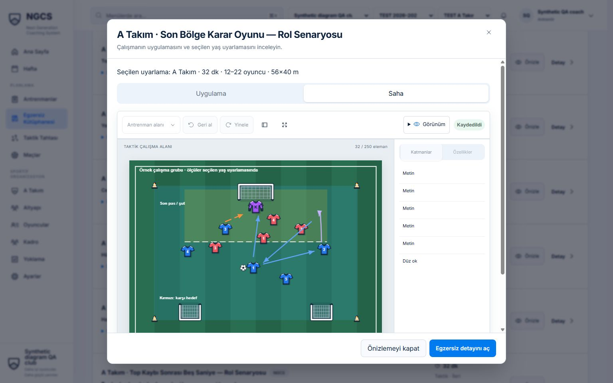

# Hazır egzersizlere özgü çizimler — 2026-10-27

## Sonuç ve yayın durumu

BL-077 / audit A16 için 24 ayrı çalışma organizasyonu, beş birincil yaş grubunda
120 yeni **DRAFT** sürüm olarak hazırlandı. Her yaşın 24 çizimi, kimlik/metin/renk
alanları çıkarıldıktan sonra da birbirinden farklıdır. Çalışma rehberleri çizimdeki
rolleri, başlangıcı, uygulama sırasını, başarı ölçütünü ve rotasyonu açıklar.

Bu bir içerik revizyonudur; API, veri modeli, migration, bağımlılık veya uygulama
ekranı değişmedi. Tarihî v1 manifesti ve eski plan kopyaları değiştirilmedi.
İlk hazırlık tesliminde kalıcı aktarım/yayın yapılmamıştı. Kullanıcı ardından
120 yeni içeriği Fatih Çelebigil olarak onayladı ve yerel aynı-hesap istisnasını
v2'ye açıkça genişletti. ADR-0048 ile120 v2 yerelde yayımlandı; v1 geçmişi ve
mevcut plan kopyaları korundu.
[Sonraki yerel yayın kaydı](DRILL_DIAGRAM_LOCAL_PUBLICATION_2026-10-27.md).
Teknik inceleme bağımsız sportif sertifikasyon olarak sunulmaz.

## Kaynaklar ve üretim

- [v2 manifest](../../content/drills/ngcs-starter-diagrams-v2.json): aynı120 drillId,
  yeni kaynak checksum'ları; publicationStatus DRAFT, reviewer TBD.
- [Üretici](../../scripts/generate-drill-diagram-pack.mjs) v1'i yalnız okur.
  Isınma/soğuma8, teknik8, taktik8 özgün organizasyon ayrı modüllerdedir.
- [Regresyonlar](../../scripts/drill-diagrams.test.mjs) gerçek backend DTO/board
  doğrulayıcısını ve frontend ortak SVG exporter'ını çağırır; ikinci çizim motoru yoktur.
- [Galeri](../../apps/frontend/qa/drill-diagrams-2026-10-27/index.html)120 SVG,
  yaş/faz/arama, rehber ve indirilebilir örnekler içerir. SVG dosyaları yereldir.

Bir sürümün tek tahtası bulunduğundan komşu yaş uyarlamaları aynı çekirdek
oyuncu/kapı/ekipman düzenini korur; seçilen yaşın alanı, süresi ve karar/baskı
talimatları uygulanır. Komşu yaş için görünmeyen oyuncu veya kapı eklenmez.
Gösterilen grup büyüklüğü toplam katılımcı sayısı değildir: paralel grup/rotasyon
rehberde belirtilir; oyuncu minimumları çizilen aktif oyuncu sayısından az olamaz.

## Doğrulamalar

| Kontrol               | Güncel kanıt                                                                                                                     |
| --------------------- | -------------------------------------------------------------------------------------------------------------------------------- |
| Geometri ve sözleşme  | 5 yaş ×24 farklı geometri;120/120 gerçek DTO, saha sınırları ve ortak SVG geçer                                                  |
| Değişmez v1           | SHA256 e066c892a784c3a18ed8b14e5fb71977e2724fd0554911210d8d37cb75f7d28f                                                          |
| Node regresyonları    | 14/14; ilk tekrar testi ve incelemede bulunan yaş/baskı/kale kusurları önce kırmızı, sonra yeşil                                 |
| Kök kalite            | 18/18; tooling8, çizim14, backend941/62suite, frontend558/63file, Sites4; typecheck/lint/format/build/CDSK/link/whitespace geçer |
| Yeni test DB          | ngcs_diagram_revision_test_20261027b; mevcut migration'larla temiz kurulum                                                       |
| Aktarım               | v1 sentetik yayın baseline120; v2 ilk aktarım120 DRAFT; tekrar0 yeni/120 atlanan                                                 |
| Normal yayın kapısı   | Onaysız yayın400; yazarın kendi incelemesi403; iki ayrı sentetik kimlikle normal submit/approve/publish120 başarılı              |
| Sürüm geçişi          | Önceki120 sürümün içeriği korunarak ARCHIVED; sonraki ekleme yeni sürümü çözer; eski expectedVersionId409                        |
| Plan değişmezliği     | Yayın değişiminde eski PlanDrill içerik/tahta/not/faz ve plan süresi aynı                                                        |
| Kalıcı veri sınırı    | ngcs_local_session_dev üzerindeki41 iş tablosunun önce/sonra fingerprint'i aynı                                                  |
| Gerçek browser ekleme | Sentetik koç: v2 pas çalışması mevcut plana eklendi; eski7 nesneli v1 + yeni22 nesneli v2,32+26=58dk                             |

[Aktarım sonucu](../../apps/frontend/qa/drill-diagrams-2026-10-27/import-verification.json)
ve [browser plan sonucu](../../apps/frontend/qa/drill-diagrams-2026-10-27/plan-browser-verification.json)
sentetik fixture niteliğini açıkça taşır. Doğrudan kurulan ilk v1 yayın baseline'ı
ve sonraki sentetik reviewer kayıtları **gerçek uzman incelemesi değildir**.
Başarısız ilk test kurulumu bcryptjs bulunamadığından fixture yazımından önce
durdu; boş/migrate edilmiş ngcs_diagram_revision_test_20261027 korunur. İkinci
taze DB ile tamamlandı; hiçbir veritabanı drop/reset edilmedi.

## Görsel ve akış kabulü

İzole gerçek uygulama127.0.0.1:3518/4018 ve salt okunur galeri3537 kullanıldı.
Canonical3132/4000 ve mevcut oturumlara müdahale edilmedi.

- Masaüstü1536×960: A Takım24 organizasyonun tamamı dört faz galerisiyle
  incelendi. Pas, pres, bitiriş, üçüncü oyuncu, son bölge ve soğuma olmak üzere
  altı gerçek Konva önizlemesi açılıp farklı çizimler/sayılar kontrol edildi.
- Son bölge gerçek modalı1024×768 ve390×844 boyutlarında açıldı; ölçülen sayfa
  scrollWidth viewport'u aşmaz. Mobilde tam şema görünür, alt eylemler erişilir.
  Küçük ekran şema metinlerini büyütmek gerekebilir; tam WCAG sonucu çıkarılmadı.
- U12 galerisi tablet/mobilde; filtre sonucu4, görünür kontrol yüksekliği44px,
  mobil scrollWidth375/viewport390. Genel uygulamanın diğer audit eksikleri
  bu içerik işi kapsamında kapatılmadı.
- Galeri PNG ve SVG indirmesi IAB'de gerçek dosya oluşturdu. PNG1500×1100 görsel
  incelendi; SVG indirilen dosya üretilen SVG ile byte-identical:
  SHA25617dd3e7ecdcfbeb6462416689b9691495790c791bc594a31186c6aa4c841a6db.
  Bu kabul galeri örneğidir; uygulamanın dışa aktarım taşıyıcısında kod değişmedi.
- Ayrıca gerçek plan editöründeki yeni pas tahtasından PNG/SVG indirildi.
  PNG1500×1100 görseli incelendi. SVG'nin Node galerisine göre ok ucu trigonometrisi
  yaklaşık1e-14 fark gösterir; tüm yapı/değerler dokuz ondalığa yuvarlandığında
  aynıdır. Byte-identical iddiası bu dosya için kullanılmaz.
  [Dışa aktarım ölçümü](../../apps/frontend/qa/drill-diagrams-2026-10-27/export-verification.json).

Tüm dosya/ekran envanteri [QA README](../../apps/frontend/qa/drill-diagrams-2026-10-27/README.md).

## İnceleme ve ortam notları

Bağımsız teknik içerik incelemesi iki düzeltme turunda kale ağız yönü,
orta ön/arka rol etiketleri, reaksiyon kapı sayısı, komşu yaşta birincil yaş kuralı
sızıntısı ve soğumaya aktif baskı eklenmesini buldu. Regresyonlar eklendi;
son incelemede Critical/Important bulunmadı. Ortak constraints yaşa özel baskıyı
tekrarlamaz; gerçek detay ekranının hem yaş kuralı hem constraints göstermesi
dikkate alındı.

Son ayrı teslim incelemesi üretici/DSL, gerçek doğrulayıcı köprüsü,120 kayıtlı
SVG'nin renderer ile birebir eşliği, galeri ve kalite entegrasyonunda P0/P1/P2
bulmadı. Tarihî v1, DRAFT durumu ve yayın sınırları ayrıca doğrulandı.

İlk kalite denemesi paylaşılan backend node_modules junction'ının declaration
yolları nedeniyle TS2742 ile durdu. Backend kalite cache'i worktree'de ayrıldı.
Frontend junction'ı da Vite'ın dış dosya yolları nedeniyle test/preview için yerel
bağımlılık kopyasıyla değiştirildi; yeni paket kurulmadı, kaynak yapılandırması
değişmedi. Son tam kalite turu exit0 ve18 PASS verdi. Frontend558 test yaklaşık
285sn sürer; standart reporter ara dosya ilerlemesini yazmaz. Ayrı verbose tanılama,
ana kalite turu bitince durduruldu. Bu başarısız/yarıda kalan denemeler yeşil
kanıt olarak sayılmaz; son tam tur tek geçerli kök kabulüdür.

## Kullanım ve yayın adımları — sonradan tamamlandı

1. Kökten npm run content:diagrams:generate, content:diagrams:validate ve
   content:diagrams:review çalıştır. v1 üreticisini çalıştırıp tarihî paketi değiştirme.
2. Galeride tüm120 yeni revizyonun sportif organizasyon/yaş/alan/süre onayı alınır.
3. Kalıcı import öncesi hedef/sürüm/checksum ve özel yedek doğrulanır; somut yerel
   aktarım onayı alınır. Mevcut importer --file ile yeni DRAFT sürümler oluşturur.
4. Normal yazar → farklı gerçek reviewer → SystemAdmin akışı kullanılır.
   Bu v2 için sonraki açık yerel istisna ADR-0048 ile kabul edilmiş ve uygulanmıştır;
   diğer revizyonlar bu karardan yararlanamaz.
5. Yayın sonrasında canonical browser'da yeni kütüphane ve yeni plan eklemesi
   doğrulanır; mevcut planlar tarihî snapshot'larını göstermeye devam eder.

Bu hazırlık aşamasında commit/push istenmemişti. Önceki audit değişiklikleri özgün checkout'ta korunur;
bu iş codex/drill-specific-diagrams managed worktree'sinde incelemeye açıktır.

Kapanış: sentetik uygulama3518/4018 durduruldu ve test sekmesi kapatıldı;
viewport sıfırlandı. Canonical3132/4000 dinleyicileri aynı39636/27748 PID'leriyle
çalışıyor. Salt okunur galeri3537 inceleme için açık bırakıldı; DB erişimi yoktur.
Geçici runtime credential config'i kaldırıldı; sentetik veritabanları korunur.
Son belge/link/CDSK/QA format ve whitespace kontrolleri geçer.

Sonraki açık [commit/push talebi ve son inceleme](DRILL_DIAGRAM_PUSH_REVIEW_2026-10-27.md)
ayrı teslimdir.
