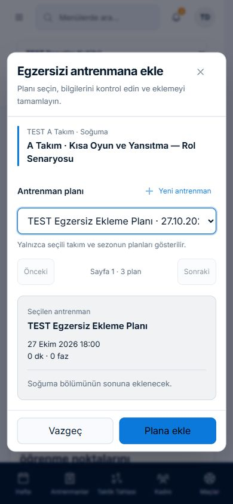
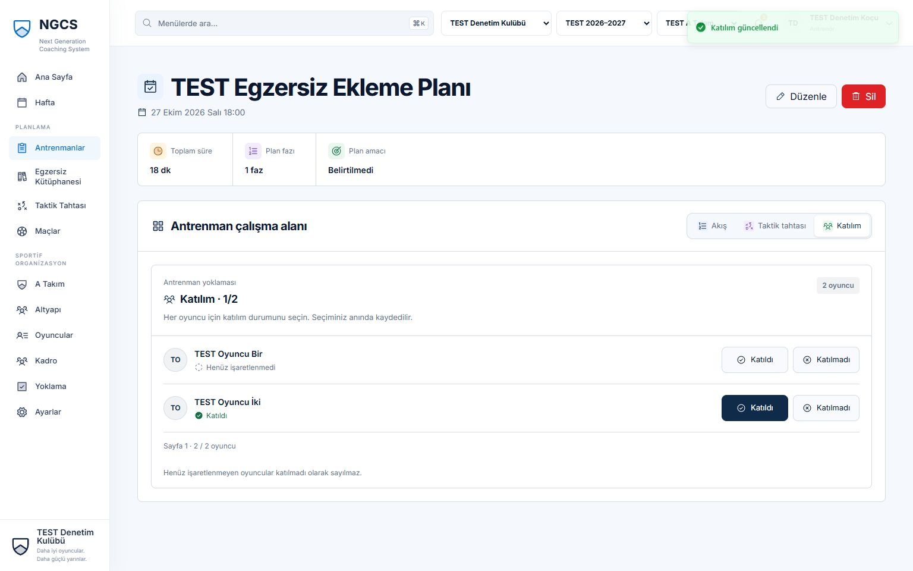

# Kapsamlı özellik ve bileşen incelemesi — 26 Ekim 2026

## Sonuç

Hazır egzersiz → mevcut plan → yoklama zinciri, taktik kayıt ve maç analizi
kullanılabilir. Ancak PLAYER kadro API'sindeki kişi sınırı, eski not paylaşımını
geri alma ve not çakışmasında taslak kurtarma eksikleri giderilmeden geniş
kullanıcı kabulü önerilmez. Yeşil kalite kapısı bu bulguları kapatmıyor.

Bu teslim **incelemedir**: uygulama/API/model/bağımlılık veya ürün davranışı
değişmedi; yeni özellik uygulanmadı. Güvenlik politikasını gevşetme, migration
veya production yayını kararı alınmadı. Öncelik ve S/M/L tahminleri iş planlama
önerisidir; owner/tarih **TBD**. İlk incelemede commit/push istenmedi;27 Ekim2026
tarihli açık istek bu hazır belge ve kanıtların mevcut branch'te yayımlanmasını kapsar.

- Baseline: `9e9b109831f7e67b729ea9ba2e27cfff1619d13c`;
  branch: `codex/product-audit-20261026`.
- [28 route ve ortak bileşen matrisi](PRODUCT_AUDIT_MATRIX_2026-10-26.md),
  [gereksinim izleri](../00-product/REQUIREMENTS.md),
  [açık işler](../20-execution/BACKLOG.md).
- Dayanak: [anayasa](../00-product/CONSTITUTION.md),
  [güvenlik modeli](../10-architecture/SECURITY_MODEL.md),
  [Phase2 yönü](../00-product/NGCS_PHASE_2_PRODUCT_ARCHITECTURE_PROPOSAL.md)
  ve matrisin bağladığı kabul edilmiş ADR'ler. Eski `Done` kayıtları güncel
  davranış kanıtı kabul edilmedi.

## Yöntem ve kanıt derecesi

**Doğrulanmış sorun** gerçek tarayıcı veya normal HTTP isteğiyle tekrarlandı.
**Kod bulgusu** erişilebilir kaynak akışına dayanır; hata enjeksiyonu yapılmış
gibi sunulmaz. **Doğrulanamadı** yeterli sonuç alınamayan veya sınanmayan
durumlardır. **Ürün önerisi** mevcut onaylı teslimin eksikliği değildir.
P1 erişim/veri kurtarma açısından önemli, P2 günlük işi etkileyen, P3 açıklık
seviyesidir. P0 sorunu doğrulanmadı.

Canlı `localhost:3132`/API4000 yeniden yapılandırılmadı; mevcut Hafta ekranı
yalnız okundu. Mutation yalnız loopback `127.0.0.1:3517/4017` ve
`ngcs_product_audit_20261026_v2` üzerinde yapıldı. Yeni disposable DB, mevcut
**sentetik** hazır-egzersiz test DB'sinin dump/restore'u ve yeni TEST
kulüp/roller/Person/atama/plan/toplantı/maçlarla kuruldu; gerçek DB kopyalanmadı.
Bu yüzden yayın kuyruğunda starter120 yanında eski sentetik test sürümleri de
vardır;149 toplamı canlı kulüp toplamı değildir.

COACH, CLUB_ADMIN ve SYSTEM_ADMIN normal tarayıcı girişiyle; PLAYER, başka takım
koçu ve diğer kulüp sınırları normal HTTP girişiyle sınandı. Parola/cookie/ham
token rapora alınmadı. Dış e-posta gönderilmedi; operator adaptörü kullanıldı.
IAB viewport'ları1536×960,1024×768,390×844; fiziksel cihaz kabulü değildir.
Scrollbar nedeniyle client genişliği1521/1009/375 olabilir; bu tek başına taşma
sayılmaz. Ekran görüntüleri tam erişilebilirlik uyumluluğunu kanıtlamaz.

[QA kanıt dizini](../../apps/frontend/qa/product-audit-2026-10-26/README.md)
122 kabul edilmiş özgün ekran dosyasını,3 red kaydını ve manifesti, DOM ölçümünü ve sanitize HTTP sonuçlarını
içerir. Temas sayfaları karşılaştırma içindir; asıl kanıt özgün görüntü/HTTP/koddur.
Eski QA görselleri güncel kanıt yerine kullanılmadı.

## Denenen akışlar

| Adım | Rol ve iş                                                      | Sonuç / ekran serisi                                                                                                                                           |
| ---- | -------------------------------------------------------------- | -------------------------------------------------------------------------------------------------------------------------------------------------------------- |
| 1    | Giriş → Ayarlar → yenileme                                     | COACH oturumu korundu; normal logout/login rol geçişleri çalıştı.001 masaüstü/tablet;013/027 üç boyut. Login mobil capture reddedildi.                         |
| 2    | Ana Sayfa → Hafta                                              | Antrenman doğru; toplantı yalnız Hafta'da var.002/003, A06.                                                                                                    |
| 3    | Kütüphane → A Takım filtresi → uygulama/saha önizlemesi        | 120 koleksiyon, A Takım için48 uyarlama; filtre/önizleme/scroll var.005/015–018.48, diğer yaş başlıklarının yayımlı SENIOR uyarlamalarını da kapsar.           |
| 4    | Detay → mevcut plan → çift tıkla ekle                          | TEST Egzersiz Ekleme Planı'nda tek Soğuma fazı18dk; başarı bağlantısı açıldı.019/020/021. HTTP duplicate409 ayrıca doğrulandı.                                 |
| 5    | Katılım → işaretle → yenile/yeniden aç                         | Oyuncu İki Katıldı;1/2 kaydı korundu.022. Hesapsız Person legacy User yoklamasında yok; F01.                                                                   |
| 6    | Taktik → top ekle → dirty gezinmeyi iptal → undo/redo → kaydet | 7→8 eleman kaydı; iki sahne dönüşümü/kaydı; çok sahnede saha kilidi. Yeni boş tahta/tam→yarım saha/undo gözlendi.023–026/046/047. Export dosya kabulü sınırlı. |
| 7    | A Takım →360 → Notlar/Aktivite                                 | Person dizini var; misafir başlığı, eski grant ve409 taslak kaybı tekrarlandı.008/014/030–034/042.                                                             |
| 8    | Maç → Analiz → Tahta                                           | Sentetik analiz kaydedildi; ayrı board açıldı.007/035/036. Sonuç/dakika increment'i yok.                                                                       |
| 9    | Admin → Kullanıcılar/davet → altyapı/takım                     | Dizin, filtre, boş davet formu doğrulaması; operator davet/kabul/replay/reissue/revoke HTTP sınandı.028/029/038/039.                                           |
| 10   | SystemAdmin → yayın yönetimi / kurulum                         | Kuyruk kesilmesi/eski banner; kurulum ilk iki adım/required/dirty guard.043–045. Final submit yapılmadı.                                                       |

## Doğrulanmış mevcut kapsam sorunları

### A01 — P1 — PLAYER kadro API'sinde başka Person kayıtları

**S/M; PLAYER; sportif kadro; BL-069.** Normal test PLAYER ile
`GET /sporting/teams/:teamId/roster/page?asOf=...&limit=100` gönderin. Beklenen
self-scope veya ret; mevcut200,7 atama,3 farklı başka Person ve takım toplamı.
Başka oyuncu360 isteği403 iken bu alternatif uç sınırı uygulamıyor. Ad/Person ID,
`birthDate`, `playerProfile`, `staffProfile` alanları var; fixture doğum tarihleri
NULL idi. Kulüpler arası ifşa veya gerçek doğum tarihi okunduğu iddia edilmez.

Kanıt: `people-admin-http.json` PLAYER roster/projection kontrolleri;
[SportingService](../../apps/backend/src/sporting/sporting.service.ts)190–234,
[authorization](../../apps/backend/src/auth/authorization.service.ts)33,
[UI ret](../../apps/frontend/src/routes/squad.tsx)47 ve güvenlik modeli147–151.
Çözüm: mevcut kişi sınırını sorgu/projection/count öncesinde uygula. Kabul:
paged/unpaged, sezonlu/sezonsuz, farklı tarih, hesapsız kişi, yabancı takım/kulüp
negatif testleri; yetkili koç/admin korunur. Bağımlılık mevcut güvenlik kararıdır;
politika değiştirerek erişimi genişletmek çözüm değildir.

### A02 — P1 — Biten takım paylaşımı UI'dan geri alınamıyor

**M; CLUB_ADMIN;360 notları; BL-070.** A ana/B misafir ataması varken A notunu
B'ye paylaşın; B atamasını bitirin. Notta “Paylaşılan: TEST U14” kalır.
Paylaşım diyalogunda eski B kutusu yok; kaydet403 verir, grant kalır. Beklenen,
artık yeni paylaşım için uygun olmayan mevcut grant'in kaldırılabilmesidir.

Kanıt:030/031; HTTP gizli eski-hedef403 ve ayrı proof notunda boş-ID revoke200;
[ShareDialog](../../apps/frontend/src/routes/player-detail.tsx)1013–1049,
[servis](../../apps/backend/src/sporting/player-note.service.ts)314/692.
Bu yeni yetkisiz grant yaratılması değil, erişim geri alma boşluğudur.
Çözüm mevcut grant ve yeni uygun hedefleri ayırmaktır. Kabul: atama bitince UI
revoke başarılı, grant/audit sürümü doğru, B okuması reddedilir; yeni ineligible
ve cross-club grant reddi korunur. Tarihçe sayfalaması hedefi gizleyip kilitlemez.

### A03 — P2 — Aktivite UI'sı20'de kesiliyor; API eşit zamanları atlıyor

**M; koç/admin; Aktivite; BL-071.** Oyuncu İki'ye aynı `validFrom` anında25
geçmiş geçici atama oluşturuldu. İlk HTTP sayfası20, ikincisi yalnız2 eski olay
ve null cursor verdi;25 yeni olayın5'i kayıp. UI ilk yanıtın cursor'ını da
saklamadığından20 sonrası gezinme sunmuyor. Beklenen her olayın tam bir kez
erişilebilir olmasıdır.

Kanıt:042 ilk liste, HTTP equal-time traversal;
[erken strict timestamp filtresi](../../apps/backend/src/sporting/player-note.service.ts)371,
sonradan tie-break442–449; [UI](../../apps/frontend/src/routes/player-detail.tsx)232.
Çözüm kaynak sorgusunda timestamp+ID sınırı ve UI devam kontrolü. Kabul:20+
aynı zamanlı/karışık kaynakta kayıp ve tekrar yok; loading/error/retry ve bağlam
değişimi doğru. Katılım createdAt/occurredAt alternatif sırası ayrıca sınanmalıdır.

### A04 — P2 —409 sonrası not düzenleme taslağı kayboluyor

**S; koç/admin; Not düzenle.** Formda metni değiştirin (032). Ayrı normal admin
HTTP oturumunda sürümü3→4 artırın; eski formu kaydedin. API409 güvenle reddeder;
UI formu kapatıp “Liste yenilendi” mesajı verir (033), taslak erişilemez.
Beklenen son sürümü ezmeden yerel metni koruyan yeniden inceleme/kopyalama yoludur.

Kanıt:032/033, `people-admin-conflict-bump.json`,
[Not kaydetme/hata akışı](../../apps/frontend/src/routes/player-detail.tsx).
Çözüm409'da alanları korumaktır. Kabul: kaybeden taslak açık kalır; kör otomatik
retry yok; son sürüm/yerel metin ve vazgeç/yeniden incele odağı ayrıdır.

### A05 — P2 — Misafir ataması ana takım gibi gösteriliyor

**S/M;360 başlık/Genel Bakış; BL-072.** A'ya temmuz PRIMARY_REGISTERED, B'ye ekim
TRAINING_GUEST atanmış oyuncuyu açın. A dizini ana takım gösterirken profil
başlığı/Futbol profili TEST U14 gösterdi. Beklenen primary ve misafir rollerinin
ayrı belirtilmesidir.

Kanıt:008/014, [aktif atama seçimi](../../apps/frontend/src/routes/player-detail.tsx)281.
Çözüm primary önceliği ve güncel kimliği tarihçe sayfasından ayırmaktır. Kabul:
ana+misafir, bitmiş/gelecek, yalnız misafir, asOf ve tarihçe pagination durumlarında
başlık tutarlı; tarihçe sayfası güncel kimliği değiştirmez.

### A06 — P2 — Bugünün Programı toplantıları kapsamıyor

**M; Ana Sayfa/Hafta; BL-073.** Aynı takım/sezonda bugün10:00 antrenman,16:00
toplantı oluşturun. Hafta ikisini (003), Ana Sayfa yalnız antrenmanı (002)
gösterir. Beklenen karma günlük program veya kapsamı açık dar etikettir.

Kanıt: [Dashboard](../../apps/frontend/src/routes/dashboard.tsx) training-only
okuması ve [Week](../../apps/frontend/src/routes/week.tsx). Çözüm ortak günlük
event projeksiyonu/ürünce açık isimlendirmedir. Kabul: toplantı/antrenman/maç
gününde kapsam/saat dilimi/sıralama ve değişiklik sonrası yenilenme aynı;
gizli görüşme bilgisi sızmaz.

### A07 — P2 — Editoryal kuyruğun devamı yok

**M; yayın yöneticisi; İçerik Yönetimi; BL-074.**100'den fazla PUBLISHED sürümle
Yayında'yı açın. Sentetik API100 kayıt, total149, `nextCursor:null`; UI149
etiketi fakat devam/arama yok. Beklenen tüm yetkili sürümlere erişimdir.
Hazır120 koleksiyonun normal kütüphane sayfalaması bu uçtan ayrıdır.

Kanıt:043, `planning-http-tactics.json` Q01,
[editoryal servis](../../apps/backend/src/drills/drill-content.service.ts),
[manage UI](../../apps/frontend/src/routes/library-manage.tsx).
Çözüm gerçek cursor/filtre/sıralama ve UI devamıdır. Kabul:121+ kayıt tam traversal;
durum değişiminde cursor sıfırlama, stale-read ve yetki testleri.

### A16 — P2 — Hazır120 içerikte yalnız dört tekrarlanan çizim geometrisi

**Doğrulanmış veri/kod bulgusu; L; hazır kütüphane; BL-077.** Kullanıcının
“Son Bölge Karar Oyunu” ekranındaki üç oyuncu/iki huni/top/tek ok düzeni üzerine
kaynak manifest ile güncel yerel PUBLISHED120 sürüm salt okunur karşılaştırıldı.
Nesne kimlikleri dışarıda bırakılıp koordinat, tür, takım, stil ve saha korununca
120 kayıtta yalnız4 farklı geometri bulundu. A Takım24 kayıtta da yalnız4 var;
hepsi7 nesneli ve yayımlı çizimler kaynak paketle birebir eşleşiyor.

Beklenen çalışma hedefi, organizasyonu ve kurallarını açıklayan egzersize özgü
çizimdir. Mevcut üretici [board(index, ageIndex)](../../scripts/generate-drill-starter-pack.mjs)
137–185 yalnız `(index % 4) * 18` ile aynı yerleşimi kaydırır. Önizleme
[version.boardDocument](../../apps/frontend/src/components/drill-preview.tsx)
alanını kaynak sürüm kimliğiyle açar; bulgu bir önizleme cache varsayımına dayanmaz.
[Sayısal kanıt](../../apps/frontend/qa/product-audit-2026-10-26/drill-board-diagnosis.json).

Önceki F05 örneklem önerisi bu somut mevcut-kapsam kusurunu yeterince açık
sınıflandırmıyordu; kullanıcı bildirimi üzerine A16 olarak düzeltildi. Çözüm:
24 temel çalışma için anlamlı saha/oyuncu/ekipman/pas-koşu yerleşimleri ve5 yaş
bağlamına uygun organizasyon; içerik kurallarıyla çizim birlikte kabul edilir.
Sırf renk/kimlik veya rastgele konum değişikliği kabul sayılmaz. Aynı gerçek
organizasyonun yaş uyarlamaları benzer olabilir; yapay120/120 benzersizlik hedefi
sportif doğruluğun yerine geçmez.

Değişmemiş v1 manifest geçmişi ve mevcut plan snapshot'ları korunur; düzeltmeler
yeni içerik sürümlerinde hazırlanır. ADR-0041 yalnız ilk değişmemiş120 sürümün
tek seferlik istisnasıdır; yeni revizyon için otomatik yayın veya aynı-hesap
istisnası varsayılmaz. Kabul: pres/bitiriş/koridor/geçiş/soğuma örnekleri görselde
ayrışır; nesne sınırları, açıklama eşleşmesi, kaydet/reopen/export ve yeni plana
snapshot doğrulanır. Mevcut planın çizimi kaynak revizyonuyla değişmez.

## Diğer mevcut boşluklar ve koşullu riskler

| Kimlik / derece / kapsam               | Rol, tekrar adımı ve beklenen–mevcut                                                                                                                                  | Kanıt; çözüm, kabul ve bağımlılık                                                                                                                                                                                                                                                                                                        |
| -------------------------------------- | --------------------------------------------------------------------------------------------------------------------------------------------------------------------- | ---------------------------------------------------------------------------------------------------------------------------------------------------------------------------------------------------------------------------------------------------------------------------------------------------------------------------------------- |
| A08 P2; kod + HTTP karakterizasyonu; M | Yeni plan/taktik oluşup yanıt kaybolursa açık retry farklı ID yaratabilir. Aynı POST iki kez gönderildiğinde iki ID oluştu. Normal çift tıklama kusuru iddia edilmez. | L11/T03; [plan formu](../../apps/frontend/src/components/training-plan-dialogs.tsx), [editör](../../apps/frontend/src/routes/tactics-editor.tsx). Sonuç sorgulama/istek kimliği değerlendirilmeli. Kayıp ACK öncesi/sonrası tek kayıt/taslak kabulü. Browser lost-response enjeksiyonu yapılmadı; yeni kontrat/model gerekirse ADR/onay. |
| A09 P2; doğrulanmış görsel/DOM; M      | 390px Player360 header client375→381, editoryal ekran375→524 taşma. Mobil arama34×34, menü/bell40×40, profil eylemleri40px, tab36px;44px hedefini sağlamaz.           | 014/030/042/043, `mobile-measurements.json`. Responsive header/tab ve ortak hedef ölçüleri;390px body yatay scroll yok, hedef44×44+, focus/scroll testleri. WCAG bütünü hakkında hüküm değil.                                                                                                                                            |
| A10 P3; UI/belge; S                    | Yayında kayıt varken banner “120 taslak, uzman TBD” diyor; yerel paket ADR-0039/0041 ile uyumsuz.                                                                     | 043; [manage](../../apps/frontend/src/routes/library-manage.tsx). Ortam/paket durumuna bağlı açıklama; başka ortam ve gelecek bağımsız uzman kapısı korunmalı. Eski kullanıcı yayın onayı iptal değildir.                                                                                                                                |
| A11 P2; kod bulgusu; S/M               | Player genel bakış açık takip isteği hata alınca boş dizi/0'a dönüşür; “yok” ve “okunamadı” karışır.                                                                  | [player-detail](../../apps/frontend/src/routes/player-detail.tsx). Ayrı loading/error/retry;503 ve gerçek açık notla yanlış0 gösterilmemesi. Browser503 enjeksiyonu yapılmadı.                                                                                                                                                           |
| A12 P2; kod + HTTP rol; S              | AUTHOR/REVIEW COACH API'yi kullanabilir; yönetim bağlantısı yalnız SystemAdmin'a görünür.                                                                             | [library](../../apps/frontend/src/routes/library.tsx), F01–F03 HTTP yayın süreci. Capability tabanlı giriş/açıklama; author/reviewer/admin/unauthorized dört rol UI kabulü.                                                                                                                                                              |
| A13 P3; UI semantiği; S                | Erişilebilir egzersiz49/hazır120 farklı evrenlerdir, yanlış sayı kanıtı değil. Bell tüm scoped maç3; inbox değil. “Son antrenman” en büyük gelecek tarihe göre.       | 002/005/007; [bell](../../apps/frontend/src/components/match-notifications.tsx). Kapsam/bağlantı etiketleri açıklanmalı; “son kayıt” anlamı kararlaştırılmalı. Gerçek notification F06.                                                                                                                                                  |
| A14 P2; kod bulgusu; S                 | Admin capability matrisi fetch hatasını boş diziye çevirir, yetki yok sanılabilir.                                                                                    | [account-access](../../apps/frontend/src/routes/account-access.tsx). Bağımsız error/retry; directory başarısı matrix başarısı değildir.503 fault testi yapılmadı.                                                                                                                                                                        |
| A15 P2; kod/karar bekleyen; M          | Atama UI `teamSeasonId` göndermiyor; seçili sezon Kadro tam TeamSeason filtresi kullanıyor. Seed null-season atamaları dizin3/Kadro0 üretir.                          | [AssignmentDialog](../../apps/frontend/src/routes/player-detail.tsx)1367, [roster](../../apps/backend/src/sporting/sporting.service.ts)193. Bu fixture farkı doğrulanmış ürün kusuru sayılmadı. Önce sezon-bağımsız/legacy anlamı kararlaştır; gerçek UI atama→tarihli kadro kabulü. Gerekirse mapping ADR/onay.                         |

## İleri ürün fırsatları — uygulanmadı, ayrı onay gerekir

[ADR-0021](../50-decisions/ADR-0021-football-club-operating-system-boundary.md)
vizyonu kabul eder; Phase2'nin tamamını mevcut teslim yapmaz. Aşağıdakiler
eksik MVP bileşeni diye sayılmaz.

| ID / önerilen öncelik | Kulüp işi / yeni bileşen                                                     | Kapsam, bağımlılık ve kabul örneği                                                                                                                                                                                                                                                                                                            |
| --------------------- | ---------------------------------------------------------------------------- | --------------------------------------------------------------------------------------------------------------------------------------------------------------------------------------------------------------------------------------------------------------------------------------------------------------------------------------------- |
| F01 P1                | Person katılımı, hesapsız/misafir oyuncu; gerçek süre ve seans değerlendirme | L; User→Person eşleme, [ADR-0037](../50-decisions/ADR-0037-guided-club-setup.md) sonrası hesap bağlantısı; model/migration/erişim onayı. Hesapsız kadro→yoklama→360 kimlik kaybetmez.                                                                                                                                                         |
| F02 P2                | Atama bitirme/ana takıma geçiş ve Person kimlik düzenleme UI'sı              | M/L; API var, tam lifecycle UI sınırlı. Tarih/kulüp/rol/sezon politikası netleşir; kapanan atama geçmişi/grant tutarlı kalır.                                                                                                                                                                                                                 |
| F03 P2                | Fikstür oluşturma, skor, dakika/rol ve maç sonrası değerlendirme             | L; mevcut increment hazırlık/analiz/tahta. Competition/participation modeli ve kapsam onayı; oyuncu360'a izlenebilir kaynak.                                                                                                                                                                                                                  |
| F04 P2                | Oyun modeli/prensip/rol kataloğu ve bireysel gelişim hedefleri               | L; versioned model, yaş uyarlaması/link/sahiplik kararı. Not→hedef→egzersiz→gözlem izi.                                                                                                                                                                                                                                                       |
| F05 P2                | Hazır içerikte uzman örneklem saha uygulanabilirliği kabulü                  | M;016/018'de tekrar-dinlenme/gruplama sayısı yerine genel yönergeler, 7 elemanlı örnek çizim görülür. Sportif doğruluk hükmü veya eski yayın onayını iptal değildir. A16 mevcut çizim kusuru olarak ayrıca açıldı; bu kapsam dışı özellik değildir. Uzman, çalışma hedefi/kuralları/çizim eşleşmesini kabul eder. Otomatik yeniden yayın yok. |
| F06 P3                | Bildirim merkezi, yetkili global içerik araması ve tercihler                 | M/L; event/read-state, kişisel kapsam/retention kararı. Bell maç toplamından ayrılır.                                                                                                                                                                                                                                                         |
| F07 Sonra             | Video/scouting, performans/yük entegrasyonu ve AI                            | L, fazlara bölünmeli; sağlayıcı/maliyet/lisans/safeguarding/veri kalitesi. [BL-044](../20-execution/BACKLOG.md) production politika kapısı sürer.                                                                                                                                                                                             |

## İlk beş iş ve takip sırası

1. A01 / BL-069: PLAYER roster self-scope; alternatif uç/projection/count regresyonu.
2. A02 / BL-070: Eski not grant'ini görünür ve UI'dan geri alınabilir yap.
3. A03 / BL-071: Aktivite API cursor bütünlüğü ve UI devamını birlikte tamamla.
4. A04:409'da taslağı koru; son sürümü yeniden inceleme ve odak davranışı.
5. A05 / BL-072: Primary/misafir kimliğini tarihçe sayfasından ayır.

Ardından A06 günlük kapsam → A07 editoryal sayfalama → A09 mobil hedef/taşma →
A11/A14 hata-boş ayrımı → A10/A12/A13 açıklama/navigasyon → A08 belirsiz yazım
sözleşmesi. A15 önce karar/gözlem, F01–F07 ayrı kapsam onayı. Her iş kendi dar
regresyon ve browser kabulüyle kapanır; bu rapordaki kalite sonucu kapanış yerine
taşınmaz.

## Doğrulama sonuçları ve sınırlar

- Kök `npm run quality` **bir kez**, exit0, **17/17**: backend941,
  frontend558/63 dosya, Sites4, tooling8. Typecheck/lint/format/build,
  Markdown/CDSK/whitespace geçti. Koşumda214 Markdown, CDSK36 belge/47 ADR.
  Yeni raporlar için ayrı docs/CDSK/format kontrolü yapılır; kök yeniden koşulmaz.
- Plan/taktik **30 assertion grubu** beklenen sonucu verdi. Q01/L11/T03 gibi
  PASS karakterizasyonları kusurun doğrulandığını ifade eder. CRUD/reopen/delete
  cascade, duplicate/sürüm409, toplam/DayPlan eşitliği; gerçek editorialV1→V2
  sonrası içerik/süre/tahta snapshot sabitliği geçti. Legacy/null tahta yokluğu
  yalnız yeni izole doğrudan fixture ile kuruldu; normal professional yayın yolu
  diye sunulmaz. Starter kaynakları değiştirilmedi.
- Oyuncu/admin **41 HTTP kontrolü**:40 beklenen durum; PLAYER roster403 yerine200.
  Aktivite kaybı/eski grant ayrıca içerik denetlendi. Operator davet single-use,
  reissue/revoke ve koç/oyuncu/dış kulüp not/hesap sınırları kaydedildi. Bu genel
  repository güvenlik taraması değildir. UI409 için ayrı tek sürüm-bump kaydı var.
- Geçersiz kaynaklı toplu plan isteği mevcut grafiği değiştirmedi; transaction
  ortası DB bağlantı kopması/rollback fault injection yapılmadı.
- İlk seed'de harness geçersiz position enum'u kullandı; business test öncesi
  durdu. İlk disposable DB korundu; düzeltilmiş fixture fresh `_v2`de kuruldu.
  Throttle429/eksik CSRF401 harness denemeleri kaydedilip düzeltildi. Bunlar ürün
  kusuru sayılmadı; token/guard bypass yapılmadı.
- Browser native date/datetime-local fill kalıcı form state'ine geçmedi; yeni
  plan create ve wizard sezon/final submit browser kabulü **doğrulanamadı**.
  Bu otomasyon sınırı tek başına ürün bug'ı değildir; API yeni plan lifecycle geçti.
  Kütüphanenin “Yeni antrenman” dalında ayrıca ekleme onayı bu koşumda browser'da
  tamamlanmadı.038/039'daki boş sonuç ve çift staff satırı fixture/atama kapsamıdır.
- İki sahne kaydedildi. PNG download-event kontrolü60s araç zaman aşımıyla kesildi;
  dosya yolu alınamadı, SVG kontrolüne ulaşılmadı. **Güncel PNG/SVG dosya ve byte
  eşitliği doğrulanamadı.** Geçmiş PR kanıtı bu koşumun yerine geçmez; yeni PNG
  regresyonu hükmü de çıkarılmaz. Tam drag/rotate/playback matrisi tekrar edilmedi.
- Yanlış route/loading görüntüleri yeniden alındı.001-mobile390×293,021-tablet1009×631 ve021-mobile375×234 anomalik çıktığından
  exact-viewport kabulünden reddedildi;022 Katılım üç boyut kanıtı ayrıdır.
  Diğer PNG'ler SDK tarafından orantılı küçültülebilir; gerçek piksel ve istenen
  viewport manifestte ayrı tutulur.
  Başlangıç dialog odağı, Tab geçişi ve taktik/kurulum dirty guard gözlendi;
  tüm tab sırası/focus-return/kontrast/ekran okuyucu/fiziksel touch kabulü yoktur.
- Browser lost-response/503/delayed stale-response enjeksiyonu, bütün rol×viewport
  kombinasyonları, public reset/expired-token UI kabulü **doğrulanamadı**.
  Yeşil unit testler bu alanların uçtan uca kabulü değildir.
- Retained DB41 business tablosunun count+hash öncesi/sonrası eşitliği doğrulandı;
  yalnız refresh/security olayları hariçtir. İzole DB'ler kanıt için korunur,
  yalnız audit API/UI süreçleri kapatıldı. Gerçek uygulama çalışır kalır.

## Belge uzlaştırması ve kapanış

Gereksinimlere audit izleri, backlog'a açık remediation kayıtları eklendi.
BL-056/M5.3 eski taslak/aktarım durumu yalnız ADR-0039/0041'in **yerel**120 yayın
kararıyla uzlaştırıldı; manifest başlangıç DRAFT niteliği ve gelecek/production
bağımsız inceleme kapısı korundu. Runbook wizard ve Integrations persistent-session özeti uzlaştırıldı. Project Boot sonraki-adım özeti yenilendi;
geçmiş kabul raporları geriye dönük değiştirilmez.

Yeni ADR gerekmedi: bu teslim karar/kontrat değişikliği değil, kanıt ve açık iş
kaydıdır. A08/A15 ve ileri fırsatların karar ihtiyacı kendi işlerindedir.

Kapanış doğrulaması:122 kabul edilmiş ekran dosyasının SHA256 kontrolü geçti,3 anomalik
capture reddedildi. Son217 Markdown bağlantı taraması/CDSK/Prettier/whitespace
geçti. Bağımsız salt okunur incelemenin üç önemli kanıt düzeltmesi uygulandı;
inceleme tesliminde kalan Critical/Important bulgu yok. Bu, raporlanan uygulama
kusurlarının giderildiği anlamına gelmez. [Artefakt kontrolü](../../apps/frontend/qa/product-audit-2026-10-26/artifact-check.json)
ve [inceleme özeti](../../apps/frontend/qa/product-audit-2026-10-26/review-summary.json).

2026-10-26 kullanıcı çizim bildirimi ek kontrolü: mevcut yayımlı120 kaynakta
4 geometri salt okunur doğrulandı (A16/BL-077). Bu ek işlem root kalite kapısını
yeniden çalıştırmadı; runtime veya DB mutation yapmadı.

## Yayın incelemesi — 27 Ekim 2026

Kullanıcı diğer bekleyen ürün denetimi değişikliklerinden hazır olanların commit
edilip push edilmesini istedi. Bu teslim ana rapor,28 route/ortak bileşen matrisi,
gereksinim/backlog/milestone ve operasyon/oturum belge uzlaştırmaları,122 özgün
ekran görüntüsü,10 temas JPG'si ve temizlenmiş JSON kanıtlarıdır. Kod düzeltmesi,
PR veya main merge bu isteğin kapsamında değildir. P1 bulguları açık kalır;
raporun yayımlanabilir olması uygulamanın kullanıcı kabulüne hazır olduğu anlamına gelmez.

Yeni salt okunur artefakt kontrolünde122/122 özgün dosyanın SHA256 ve gerçek
piksel ölçüsü manifestle eşleşti;132 görüntünün tamamı decode edildi. Üç
reddedilmiş dosya sürümlenen dizinde yok. **Özgünler `.png` adını taşısa da gerçek
kodlama122 dosyada JPEG'dir**; baytlar ve manifest hash'leri korunarak yayımlanır,
yeniden kodlama yapılmadı. Önceki PNG ifadesi dosya adını anlatıyordu. Manifestin
bazı tarihsel başlık dizeleri encoding hatalıdır; bunlar yeniden yazılmadı ve
ekran kabulü için metin kanıtı sayılmaz. Asıl görsel, URL, hash ve piksel alanı
kullanılır. Temas görselleri ikincil karşılaştırma kanıtıdır.

11 tarihsel JSON yeniden parse edildi; ham JWT, credential içeren PostgreSQL
URL'si, özel anahtar veya ham credential alan değeri bulunmadı.30 plan/taktik
karakterizasyonu,41 kişi/admin kontrolü ve açık kalan tek403→200 uyuşmazlığı
raporla tutarlı.26 Ekimdeki17/17 kalite koşumunun özel logu doğrulandı; yeniden
test koşulduğu iddia edilmez. Runtime kaynakları audit baseline'ıyla aynı,
yayın değişikliği belge/kanıtla sınırlı. Yeni belge/format/CDSK/whitespace
kontrolleri kesin commit ağacında yapılır. [Yayın receipt'i](../../apps/frontend/qa/product-audit-2026-10-26/publication-review.json).

Retained41 tablo değişmezliği ve süreç PID'leri26 Ekim incelemesinin tarihli
kanıtıdır. Sonraki kullanıcı onaylı [oyuncu ekleme](SYNTHETIC_TEAM_ROSTERS_2026-10-27.md)
ve [sezon bağlantısı](FIRST_TEAM_SEASON_LINK_2026-10-27.md) yerel iş verisini
değiştirdi; bunlar audit izolasyonunun ihlali değildir. Tek oyuncu için sezona
bağlama, A15'in genel UI/sezonsuz atama anlamını çözmüş sayılmaz. A16 için yeni
çizim/sürüm yayını bu rapor tesliminde yapılmadı.
