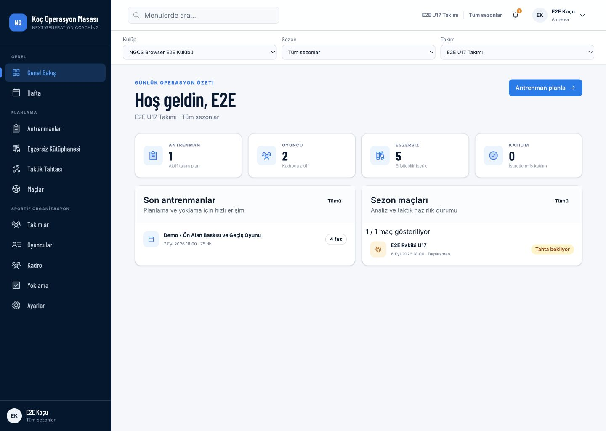
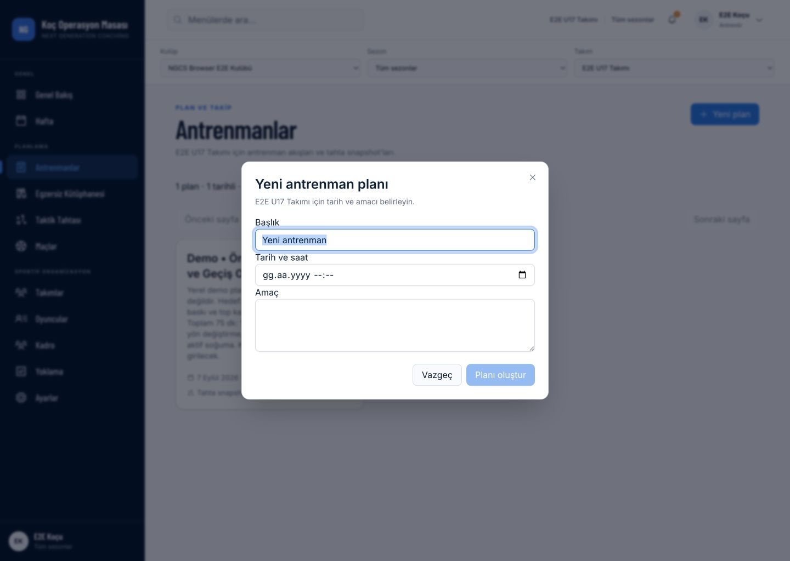

# BL-047 — UI Migration Foundation Verification

- Date: 2026-09-07
- Verdict: **Pass for phase 1 only**; phases 2–8 remain open.
- [Inventory, architecture and sequence](../20-execution/UI_MIGRATION_PLAN.md).
- Scope: existing frontend design tokens and primitive CSS classes. No API,
  model/migration, permission, validation, session or football-domain changes.

## Delivered

The current UI is hybrid: 17 owned shadcn/Radix primitive modules and two global
CSS files (1,220 + 1,507 lines before this slice). No shadcn reinitialization or
new dependency was needed. Existing typography, navy/blue/amber identity and
responsive breakpoints remain the reference, not default shadcn demo styling.

`apps/frontend/src/styles/tokens.css` now owns existing brand/semantic colors,
radius mapping, body/display font references, sidebar/gutter/section/modal
dimensions and an inactive dark palette. The 33 old muted text usages now refer
to `--legacy-muted-foreground` with the same #617089 value; shadcn `--muted` is
a surface. Dark pages, chart semantics, form density and page-specific shadow
convergence are not claimed complete.

Thirteen primitive modules changed only class-level surface/size references:
Button, Badge, Input, Textarea, Select, Alert, Dialog, Sheet, DropdownMenu, Tabs,
Skeleton, ScrollArea and Tooltip. Card/Avatar/Separator/Sonner are retained.
No new wrapper layer, component props or DOM changes. CSS cleanup is not claimed:
the root token definitions moved, but legacy selector families were not deleted.

## Checks

| Gate | Result / scope |
| --- | --- |
| Focused token and primitive regression | 9/9 passed in two new files |
| Backend unit | 655/655 passed, 48 suites |
| Frontend unit | 152/152 passed, 28 files |
| Full `npm run quality` | Pass; repository/backend/frontend formatting, typecheck, lint, unit, builds, packaging, local links, CDSK and whitespace |
| Sites packaging tests | 4/4; packaging only, no publication |
| Browser | Local dashboard + plan dialog; no submitted business writes |
| Protected scope fingerprint | Exact before/after equality for pre-existing backend, API/session/workspace and frontend package/lock diffs |
| API/browser full E2E; migration | Not run in this CSS-only slice; no claim of renewed tenant/migration coverage |

After documentation updates, frontend formatting and local links (106 Markdown
files, zero broken links), CDSK and `git diff --check` passed again. Prisma's
existing package.json configuration deprecation warning remains; no dependency
or Prisma configuration change is included here.

The focused tests cover muted compatibility/import ordering/current light values,
Button disabled/asChild behavior, Input ref/native validation/controlled value,
Textarea controlled value/class override, status surfaces, Dialog and Sheet
title/focus/Escape/trigger return, and keyboard Tabs activation/panel linkage.
They do not replace real-browser CSS evaluation. Select/Dropdown/Tooltip and
notification interaction coverage remains phase 2 work.

Protected diff SHA-256 before and after:
`e19505d16184ab5ae22ac8ab769d6c096666f0a9a312c56f1e435d0e3551d4aa`.
The repository already contained extensive uncommitted user work. These checks
compare against turn-start state, not against a clean origin revision. No
stage/commit/push, DB reset, seed or migration was performed. Normal local login
was exercised after a prior password-reset session expired; authentication may
create/rotate ordinary session records. No unchanged-all-DB fingerprint claim.

## Visual / interaction review

Screenshots were captured from the running app, saved, reopened and inspected as
before/after pairs at the same viewport and visible state. Dashboard scope is the
existing synthetic local club/team and “Tüm sezonlar”; counters are 1/2/5/0.
The initial dashboard baseline was rendered before re-login; the after state was
freshly authenticated with the same scope and displayed values. Images use the
browser's JPEG output; comparison is visual, not a pixel-exact numeric assertion.

| Flow step | Health and observed result | Remaining finding |
| --- | --- | --- |
| 1. Dashboard, 1440×1024 | Preserved: navy full rail, four stats, side-by-side lists, CTA, title hierarchy | Source-specific CSS still exists; phase 3 layout pilot |
| 2. Dashboard, 1024×900 | Preserved: icon rail, scope controls, 2×2 stats, readable lists | Full tablet audit of other routes not yet done |
| 3. Dashboard, 390×844 | Preserved with known issue: stacked content and five bottom task links | Existing account-menu trigger is visually blank and lacks an accessible name; phase 3 |
| 4. Trainings → new plan dialog, 1440×1024 | Preserved: visible title/description, initial title focus, disabled Create without date, same field sizes; Escape returns focus to New plan | Existing field labels/controls are tightly packed; phase 4 spacing pattern, validation unchanged |
| 5. Mobile menu Sheet | Opens with correct navigation; Tab reaches a link; Escape closes and returns focus to menu trigger | Not a complete screen-reader/contrast audit |

No new visual regression was observed in these paired states. Global CSS and
shared primitives have broader consumers: this is not proof that every route,
permission, empty/error/loading state or dark mode is visually complete. Formal
WCAG level and browser support matrix remain TBD.

### Screenshot evidence

| State | Before | After |
| --- | --- | --- |
| Desktop | [1440](../../apps/frontend/qa/ui-migration-2026-09-07/01-dashboard-before-1440.jpg) | [1440](../../apps/frontend/qa/ui-migration-2026-09-07/01-dashboard-after-1440.jpg) |
| Tablet | [1024](../../apps/frontend/qa/ui-migration-2026-09-07/02-dashboard-before-1024.jpg) | [1024](../../apps/frontend/qa/ui-migration-2026-09-07/02-dashboard-after-1024.jpg) |
| Mobile | [390](../../apps/frontend/qa/ui-migration-2026-09-07/03-dashboard-before-390.jpg) | [390](../../apps/frontend/qa/ui-migration-2026-09-07/03-dashboard-after-390.jpg) |
| Plan dialog | [1440](../../apps/frontend/qa/ui-migration-2026-09-07/04-training-dialog-before-1440.jpg) | [1440](../../apps/frontend/qa/ui-migration-2026-09-07/04-training-dialog-after-1440.jpg) |
| Mobile Sheet | N/A — after-only interaction smoke | [390](../../apps/frontend/qa/ui-migration-2026-09-07/05-mobile-menu-after-390.jpg) |

Desktop after:

Dialog after:

## Next / rollback

Finish phase 2 remaining primitive interaction/type/density review, then pilot
PageContainer/PageHeader/Actions on dashboard/settings before wider adoption.
Address the named mobile menu finding in phase 3 and form spacing in phase 4.
BL-043 pilot acceptance, BL-044 safeguarding, BL-009 and M4 remain independent
approval gates. No new ADR is required within Accepted ADR-0011/0013 technology.

Rollback, if necessary: reverse only this slice's token import/extraction,
compatibility references and 13 primitive class substitutions using the reviewed
patch. Do not reset the dirty working tree or remove unrelated user changes.
No data rollback is needed for this presentation-only implementation.
